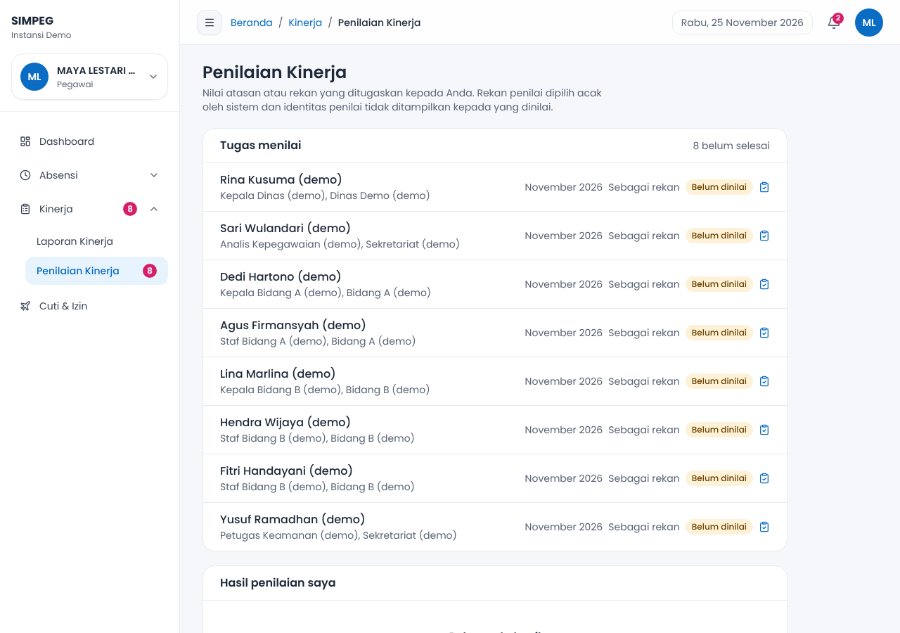
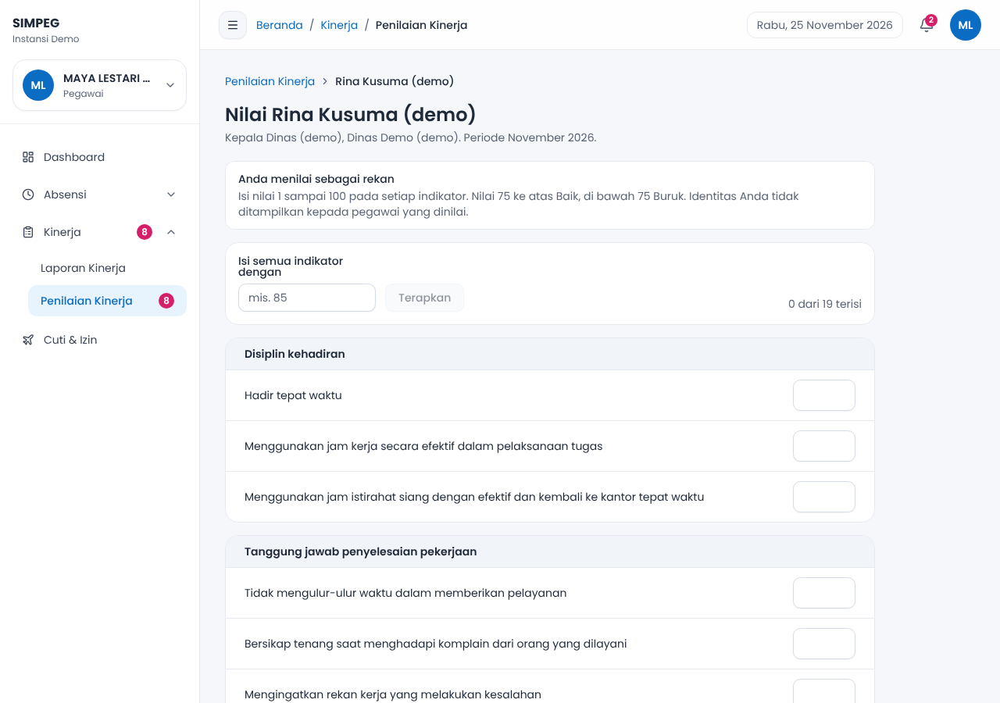
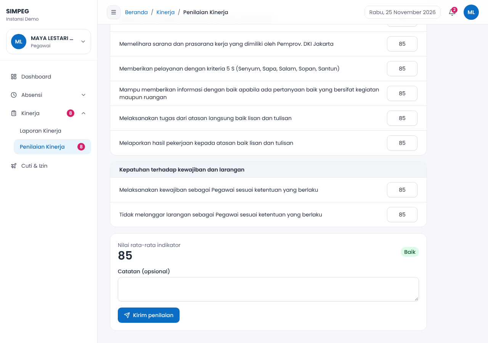
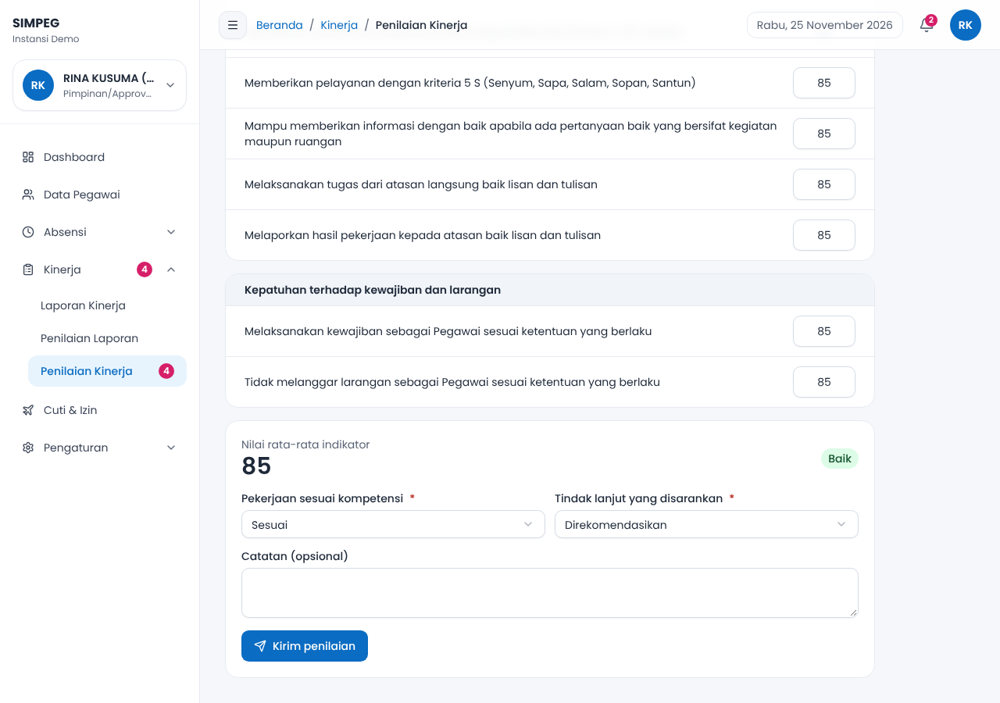

# Panduan Menilai Atasan, Bawahan, dan Rekan

Panduan ini untuk pegawai yang mendapat tugas menilai kinerja pegawai lain pada periode penilaian bulanan. Gambar memakai data demo.

## Sebelum mulai

- Tugas menilai dibagikan oleh admin kepegawaian. Anda menerima notifikasi "Penilaian kinerja ... Anda ditugaskan menilai N pegawai".
- Ada dua peran:
  - **Atasan**: Anda adalah atasan langsung pegawai itu (diatur di data pegawai). Anda juga mengisi kesimpulan kompetensi dan tindak lanjut.
  - **Rekan**: Anda dipilih acak (atau ditunjuk admin). Identitas Anda tidak ditampilkan kepada pegawai yang dinilai.
- Penilaian dilakukan sekali per periode (satu bulan) dan hanya selama periode masih terbuka.

## Langkah 1. Buka daftar tugas

Menu **Kinerja → Penilaian Kinerja**. Angka merah pada menu menunjukkan tugas yang belum selesai.

Setiap baris menampilkan nama pegawai, jabatan, unit, periode, peran Anda (**Sebagai rekan** atau **Sebagai atasan**), dan statusnya. Klik baris untuk membuka lembar penilaian.

## Langkah 2. Isi nilai tiap indikator

- Ada **19 indikator** dalam tiga kelompok: Disiplin kehadiran (3), Tanggung jawab penyelesaian pekerjaan (14), dan Kepatuhan terhadap kewajiban dan larangan (2).
- Isi **bilangan bulat 1 sampai 100** pada kolom di kanan tiap indikator.
- Untuk mempercepat, ketik angka di **Isi semua indikator dengan** (misalnya 85), klik **Terapkan**, lalu ubah indikator yang berbeda.
- Penghitung "N dari 19 terisi" menunjukkan kemajuan. Semua indikator wajib terisi.

Acuan nilai:

| Rata-rata | Predikat |
|---|---|
| 75 sampai 100 | Baik |
| di bawah 75 | Buruk |

Nilailah berdasarkan yang Anda amati selama periode itu, bukan kesan umum. Gunakan kelompok nilai yang sama untuk perilaku yang sama pada semua pegawai agar adil.

## Langkah 3. Periksa ringkasan, lalu kirim

### Sebagai rekan

Di bagian bawah tampil **nilai rata-rata** dan predikatnya. Catatan bersifat opsional (maksimal 1.000 karakter). Klik **Kirim penilaian**.

### Sebagai atasan

Selain nilai, isi dua kolom wajib:

- **Pekerjaan sesuai kompetensi**: Sesuai atau Tidak sesuai.
- **Tindak lanjut yang disarankan**: Direkomendasikan, Pembimbingan, Mutasi, atau Diberhentikan.

Tombol kirim aktif setelah semua indikator dan kedua kolom itu terisi.

## Setelah dikirim

- Status di daftar tugas berubah menjadi **Selesai** disertai nilai rata-rata Anda.
- Selama periode belum ditutup, buka lagi tugasnya dan klik **Perbarui penilaian** untuk memperbaiki.
- Setelah periode ditutup penilaian tidak bisa diubah. Pegawai yang dinilai baru dapat melihat hasilnya (**Hasil penilaian saya**) pada saat itu.
- Admin akan mengirim pengingat bila tugas belum selesai.

## Kerahasiaan

- Pegawai yang dinilai tidak melihat siapa rekan penilainya. Hanya admin penilaian yang melihat daftar penilai dan statusnya.
- Nilai tidak dicatat di log audit. Yang tercatat hanya bahwa penilaian dikirim.

## Pertanyaan umum

**Tugas menilai tidak muncul.** Periode belum dibuka, atau admin belum membagikan penilai. Hubungi admin kepegawaian.

**Saya ditugaskan menilai orang yang tidak saya kenal.** Hubungi admin. Admin dapat mengganti penilai selama Anda belum mengirim nilai.

**Tombol kirim tidak aktif.** Ada indikator yang kosong atau nilainya di luar 1 sampai 100. Kolom yang bermasalah ditandai. Untuk atasan, kolom kompetensi dan tindak lanjut juga harus diisi.

**Periode sudah ditutup.** Penilaian tidak bisa dikirim atau diubah. Minta admin membuka kembali periode bila perlu.

## Untuk admin

Pembagian penilai dikelola di **Kinerja → Kelola Penilaian → Penilai**: acak otomatis, pemetaan unit, tambah atau ganti penilai manual, hapus semua penilai, dan kirim pengingat. Penilaian laporan kinerja harian oleh atasan adalah fitur terpisah di **Kinerja → Penilaian Laporan**.
